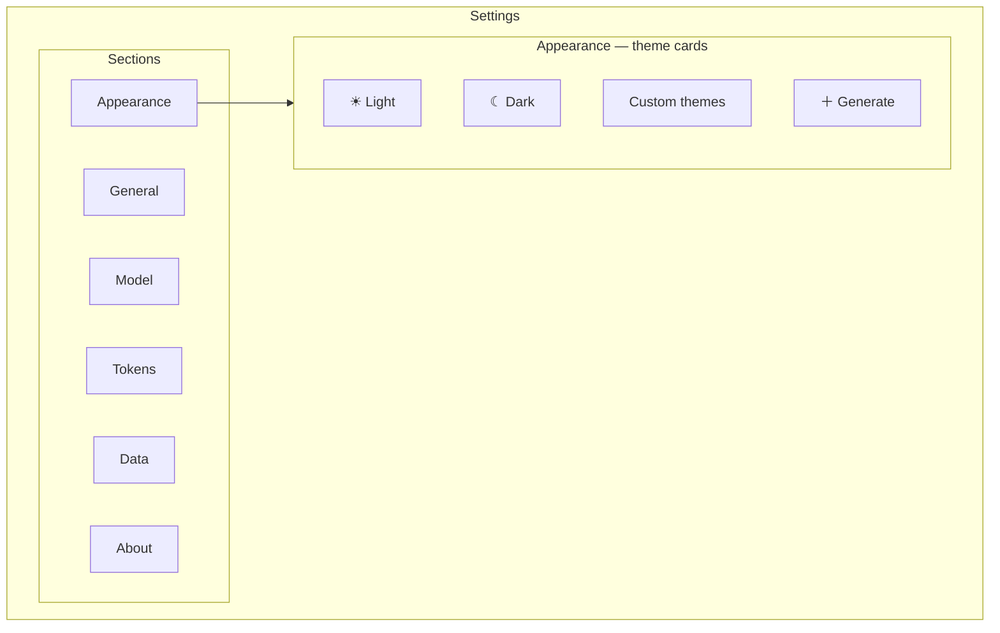
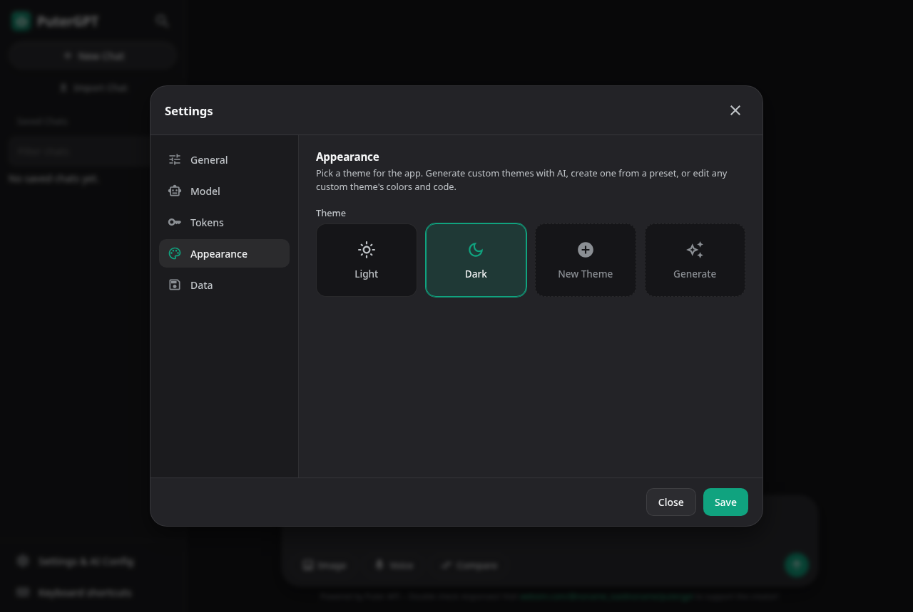
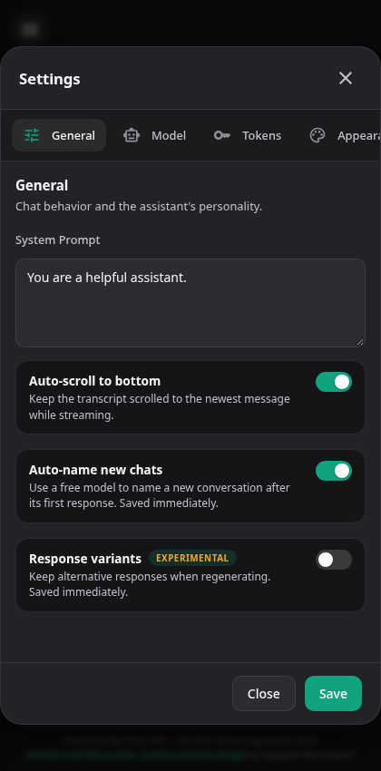

# PuterGPT

A browser-based AI chat client for [Puter.ai](https://puter.ai) models. PuterGPT is a static HTML, CSS, and vanilla JavaScript app: there is no build step, application server, or framework.

**[Open PuterGPT](https://noname-isaidnoname.github.io/PuterGPT/)**

## Get started

1. Open **Settings & AI Config** in the sidebar.
2. Add a Puter API token under **Tokens**, or use **Quick Register**.
3. Choose a model and start a chat.

To run a local copy, serve the files from this directory:

```bash
git clone https://github.com/noname-isaidnoname/PuterGPT.git
cd PuterGPT
python3 -m http.server 8000
```

Open `http://localhost:8000`. A secure context such as HTTPS or localhost is needed for features including service workers and some clipboard and speech APIs.

## Interface overview

Settings uses a sidebar for its sections and theme cards in Appearance:



This is a schematic, not a screenshot. See the screenshots below.

| Settings and theme cards | Mobile settings |
| --- | --- |
|  |  |

## Features

- **Models and streaming:** Choose a Puter model, watch responses stream, stop generation, and see estimated costs. Supported models can use images and web search.
- **Per-chat parameters:** Set temperature and a maximum output-token limit in Settings → Model. Blank fields use model defaults; support and limits vary by model.
- **Edit and experiment:** Edit messages and regenerate. Enable experimental **Response variants** in Settings → General to retain alternative answers. Switching an older response requires confirmation before later dependent messages are removed.
- **Compare models:** Use the composer’s Compare button to send the same prompt to two models with independent stop controls. Comparison requests may incur charges and their results are not saved to the chat.
- **Organize and search:** Filter chat titles in the sidebar, pin conversations, and search saved chats. New chats can be named automatically using a free model when one is available.
- **Backups and exports:** Export individual chats as JSON or Markdown, print a transcript, or use Settings → Data to export and merge a full backup. API tokens are excluded from backups unless explicitly selected. Backups and exports may contain prompts, images, and other private conversation data.
- **Sharing and input:** Share a chat using the mobile share sheet when available, or copy its link. Supported browsers also offer voice input.
- **Themes:** Choose a built-in theme, or create a custom theme (generate one with AI, or start from a dark/light preset and tweak it yourself). Edit any custom theme's colors and JavaScript effects — enable the live preview to see changes as you type. Only import themes and backups you trust — custom themes can contain JavaScript effects.
- **Tokens:** Manage multiple Puter API tokens — add them by hand or via Quick Register — and opt in to token rotation so a failing token rotates to the next one automatically.
- **Installable shell:** On supported browsers, install the app and reopen its cached interface offline. Generation and other Puter API operations still require a network connection. Updates wait for you to choose Reload.
- **Keyboard access:** Press `?` or use **Keyboard shortcuts** in the sidebar for the full list. `Ctrl+K` focuses the chat filter, `Ctrl+,` opens settings, and `Ctrl+Shift+E` exports the current chat; use `Cmd` instead of `Ctrl` on macOS.

## Data and privacy

Chats, settings, and tokens are stored locally in IndexedDB; custom themes are also mirrored in localStorage. Clearing browser data removes local data, so keep a backup. Restore merges data and lets you keep existing records, overwrite them, or keep both chats and themes when IDs collide.

If the two theme stores differ, startup and backups preserve both copies. Local themes keep their IDs; conflicting IndexedDB copies receive recovery IDs. Startup reports recovered database copies. If a backup encounters unreconciled copies, its `themeRecovery` field identifies the source IDs, and the export notification flags the discrepancy. Restore also reconciles both existing stores before applying your chosen collision policy.

Puter requests send the selected token and relevant prompts or attachments to Puter.ai. The app also loads libraries and fonts from CDNs, and Quick Register loads Puter's SDK. A chat share link contains the shared conversation in its URL; anyone with the link can read it. Token export, token-inclusive backups, and custom JavaScript effects are explicit features that can expose local data, so treat their outputs and sources as sensitive.

## Known limitations

- The app has no server-side chat sync; another browser or device needs an exported backup.
- The service worker caches the app shell and available CDN assets, not API responses. Offline use does not generate answers.
- Model support for generation parameters, image input, and web search varies. Comparison responses are read-only.
- Browser support for native sharing, speech recognition, installation, and clipboard access varies.
- In a websim.com iframe, browser permissions and embedding restrictions can affect these features; share links use the websim host when appropriate.
- Legacy `puter_*` localStorage data is migrated to IndexedDB during startup when the corresponding database tables are empty. Existing database records are not replaced by that migration.
- The app depends on third-party scripts and the Puter API. If a required library cannot load, a blocking error is shown instead of a partially functioning interface.

## Project

Source and issue tracker: [github.com/noname-isaidnoname/PuterGPT](https://github.com/noname-isaidnoname/PuterGPT).

Contributors: see [CONTRIBUTING.md](CONTRIBUTING.md) for local development and verification tooling. Editors of the app should read [AGENTS.md](AGENTS.md) for the project map and internal conventions.
